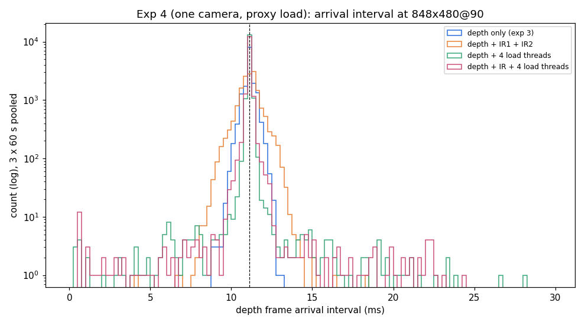
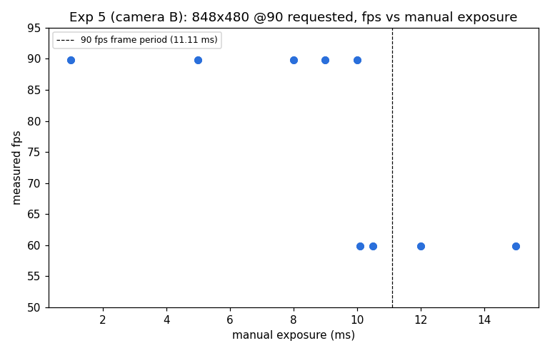
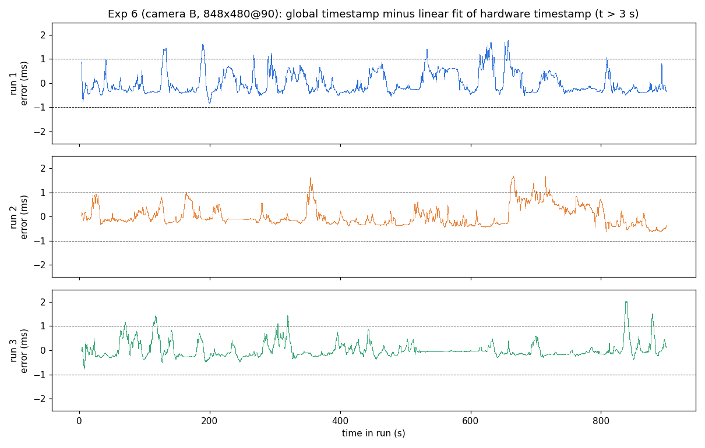
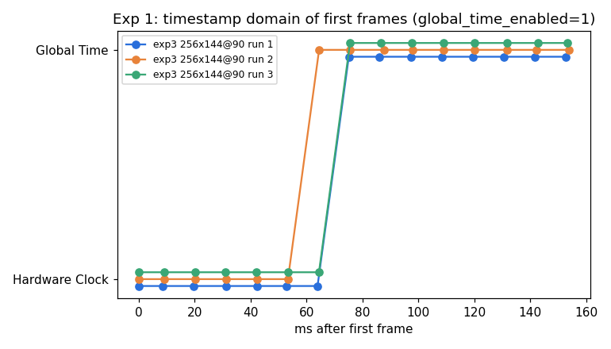
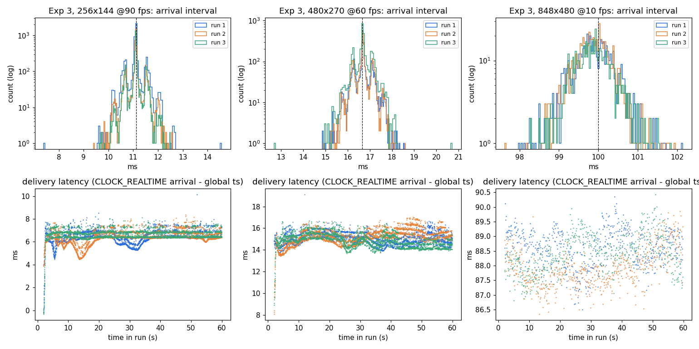
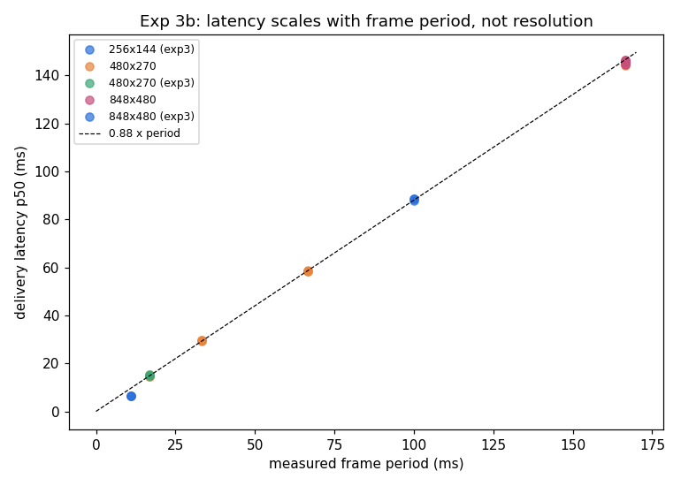
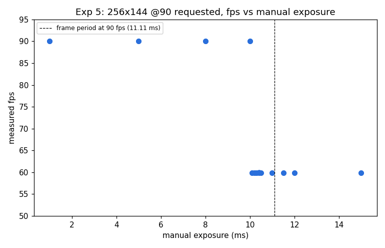
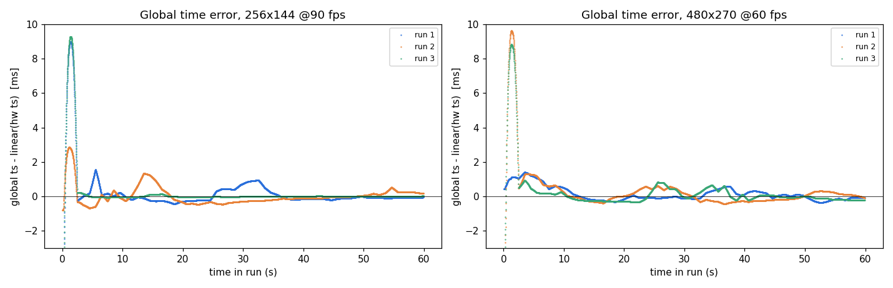

# Dual D435i capture on Jetson Orin Nano: measured unknowns

Status: **one camera, USB 3.2, target mode.** Camera A (234322070408) went back to the lab. Camera B (234322070144) is now
connected with a working USB 3 cable at 5 Gbit/s, so the target mode 848x480 Z16 @90 is available. The experiments were
revised to use one camera only (revised plan below). **Sync and master/slave operation (exp 7) and every comparison between two
cameras are left open.** Nothing here says anything about hardware sync.

**Firmware.** On 2026-11-15 you amended rule 2 to allow firmware flashing. Camera B was updated from 5.16.0.1 to
**5.17.3.10**, the same version as camera A and the minimum that librealsense 2.59.1 lists for the D435i. Experiments 0-8 below were
measured on 5.16.0.1. A re-check on 5.17.3.10 (section "Firmware update" below) found the same results. Exp 4, 6 and 8 were
not repeated on the new firmware.

The earlier results from camera A over USB 2.0 are kept in Appendix A. They come from a different unit with different firmware
in different modes; where they disagree with camera B, the camera B result applies to the target setup.

All paths are relative to `~/rs_investigation/` on the Jetson. Logs for camera B are `logs/expB*`; logs for camera A are
`logs/exp*_A_*`, `logs/f*`, `logs/exp1_*`, `logs/exp3b*`, `logs/exp3c*`.

## Revised plan (one camera)

| # | Original question | Revised for one camera | What it cannot answer |
|---|---|---|---|
| 0 | Inventory | Inventory of camera B on USB 3 | - |
| 1 | Timestamp domain, metadata | Same, at 848x480 @90, global time 0 and 1, 3 x 15 s each | - |
| 2 | Modes and options | Same, on USB 3 | - |
| 3 | One camera at 90 fps | Same, at 848x480 @90, 3 x 60 s. Rule-9 follow-up: frame period in 6 modes | - |
| 4 | Two cameras at 90 fps | **Stand-in load on one camera**: (a) depth + IR1 + IR2 Y8, which is 2x the USB payload of one depth stream and 3 callbacks per frame; (b) depth + 4 CPU/memory load threads; (c) both. 3 x 60 s each. (d) 30 start/stop cycles | Two devices on the hub, two SDK pipelines, the hub/controller limit, cross-camera effects |
| 5 | Exposure vs fps | Same, at 848x480 @90; auto exposure behaviour; the fps carry-over seen on A | - |
| 6 | Offset and drift between cameras | Camera clock vs Jetson clock and global-time error, 3 x 15 min | Offset and relative drift between two cameras, pairing rate |
| 7 | Sync modes without cable | **Not run, left open.** `inter_cam_sync_mode` was only read (0), never written | Everything |
| 8 | Callback cost | Same, at 848x480 @90 with log / memcpy / keep, 3 x 60 s each | Two cameras' callbacks at once |

## Summary

| # | Unknown | Status | Measured value (camera B, 848x480 Z16 @90, USB 3.2) | Recommended design decision |
|---|---|---|---|---|
| 0 | System and camera | Answered | Same Jetson setup as before (L4T R36.4.3, kernel 5.15.148-tegra, 25W). B: USB 3.2, 5000M, port 2-1.3-3. FW was **5.16.0.1**, below the SDK 2.59.1 minimum for D435i (5.17.3.10); **now flashed to 5.17.3.10**, as camera A | Check `usb_type_descriptor` starts with "3." and firmware >= 5.17.3.10 at startup |
| 1 | Timestamp domain | Answered | gt=0: 100% Hardware Clock. gt=1: first **5-7 frames (52-75 ms)** Hardware Clock, then Global Time to the end. All 9 metadata fields present except Actual Fps on 2 frames per stream. Same as camera A | Matcher checks the domain of every frame and drops frames until it is Global Time |
| 2 | Modes | Answered | 848x480 Z16 at 6/15/30/60/**90**. 90 fps also at 640x480, 640x360, 480x270, 424x240, 256x144. IR Y8 848x480 @90 on both imagers. Stored AE limit 165000 us | Target mode is available. Set all options explicitly at startup |
| 3 | One camera at 90 fps | **Pass** | 3 x 60 s: **0 dropped**, arrival interval p99 12.08 / worst 12.17 ms, max 13.06 ms, latency p50 9.3 / p99 10.5 ms, CPU 3.4% | Single-camera transport is not a bottleneck |
| 3m | Actual frame rate | Answered (unusual) | Camera B delivers **89.87 fps** (period 11.128 ms) in all 90 fps modes, 59.90 at 60, 29.99 at 30: **0.14% slow**, confirmed by host clock. **Same on FW 5.17.3.10, so not firmware.** Camera A delivered 90.02 fps (11.110 ms) | Do not assume 90.00 fps. Two free-running cameras can differ by ~0.16%, which is one frame of slip every ~7 s. Pair by timestamp, never by frame index |
| 4 | Two cameras at 90 fps | **Blocked**; stand-in load done | Depth+IR (2x USB payload): 0 drops, arrival max 18.3 ms. With 4 load threads: 0 drops, but **gaps up to 28.1 ms (2.5 periods)**, followed by back-to-back frames. Callbacks **run concurrently** when one sensor has several streams (1141-6799 overlapping calls per run); never with depth only. 0 stalls in 30 start/stop cycles | Ring buffer of at least 4 frames per camera. Callback must be thread-safe if it serves more than one stream or camera. Two-camera test still required |
| 5 | Exposure vs fps | Answered | 90 fps up to **10000 us**; **10100 us and above gives 60 fps** (step). Auto exposure works at 848x480 on USB 3 and **caps itself at 9947 us at 90 fps** (raises gain to 54 instead), so fps held in every auto run | Auto exposure is safe for fps at 90 fps on this firmware. Manual exposure must be <= 10000 us |
| 5s | fps carry-over (seen on A) | Not reproduced | 848x480 @6 -> @30 -> @90, 3 sequences: each run at the requested rate | Keep the startup rate check anyway (cheap) |
| 6 | Clocks | Partly answered (one camera) | Camera clock vs Jetson CLOCK_MONOTONIC: **-96.8 to -97.6 ppm** (fit sign; camera clock about 97 ppm fast; camera A: -98 to -104). Global time error vs ideal: p99 1.29-1.41 ms, **max 2.0 ms** over 15 min, as **ramps of 10-40 s** at random times. Up to 10.9 ms in the first 3 s | Discard the first ~5 s. A 1 ms pairing tolerance on global time will fail; half a period (5.56 ms) should hold. Camera-to-camera values: open |
| 7 | Sync modes | **Open** (by request) | - | - |
| 8 | Callback cost | Answered (one camera) | memcpy of 814 KB at 90 fps: p50 170 / p99 249 / max 1549 us (worst run); log only p99 84 us; keep+queue p99 78 us. 0 drops in all | memcpy into the ring buffer in the callback. Leave margin for occasional 1.5 ms callbacks (12 ms under heavy load) |
| - | Health | Answered | 120 starts on camera B: **0 USB/kernel errors**, 0 stalls, tj max 55.4 C (under load), no throttling | - |

---

## Firmware update (rule 2 amended)

**Why.** Camera B had FW 5.16.0.1, camera A 5.17.3.10. librealsense 2.59.1 lists **5.17.3.10 or later** as the minimum for
D435/D435i ([release notes](https://github.com/realsenseai/librealsense/releases)), so camera B was below the minimum. You amended rule 2
to allow flashing (2026-11-15). The ban on kernel patches and reboots still applies.

**Method** (logs in `logs/fw_update/`):
1. Image: RealSense download 42256 ([D400 firmware releases](https://dev.realsenseai.com/docs/firmware-releases-d400)), downloaded on the
   Mac and copied to `deps/firmware/Signed_Image_UVC_5_17_3_10.bin`, sha256 `4c347e3a18eac97b41a97947ef3b225bc1eaf77c68ffd87598736e3cebf3e4d2`
   (`image_sha256.txt`). The camera checks the signature itself.
2. Backup of the full 2 MB flash: `rs-fw-update -s 234322070144 -b deps/firmware/backup_B_5.16.0.1.bin` (`02_backup.txt`).
3. Update: `rs-fw-update -s 234322070144 -f deps/firmware/Signed_Image_UVC_5_17_3_10.bin` (`03_flash.txt`). The tool printed
   "Device 234322070144 successfully updated to FW: 5.17.3.10" and then **crashed with a segfault while exiting** (rc 139).
   The camera was unaffected: the device list and inventory afterwards show 5.17.3.10 (`04_after_list.txt`, `logs/fw517_inventory.txt`).
   Kernel log (`03_flash_kernel.txt`): two disconnect/re-enumerate cycles and "Disable of device-initiated U1/U2 failed" at the moment
   of the first disconnect. No other errors. The camera is back on 5000M.

**Re-check on 5.17.3.10** (`src/exp_fw517.sh`, `logs/fw517_summary.txt`, `logs/fw517_B3_agg.txt`). Same methods as exp 3, 3m and 5:

| Check | FW 5.16.0.1 | FW 5.17.3.10 |
|---|---|---|
| Frame period, 90 fps modes (4 resolutions, 3 x 15 s) | 11.128 ms (89.87 fps) | **11.128 ms (89.87 fps)** |
| Frame period at 60 / 30 fps | 16.697 / 33.344 ms | 16.697 / 33.344 ms |
| Baseline 848x480 @90, 3 x 60 s: drops, arrival p99 (median / worst), latency p99 | 0, 12.08 / 12.17 ms, 10.5 ms | 0, 12.15 / 12.22 ms, 10.2 ms |
| Exposure 10000 / 10100 us | 89.87 / 59.90 fps | 89.87 / 59.90 fps |
| Auto exposure at 848x480 @90 | active, cap 9947 us | active, cap 9947 us |
| Start: Hardware Clock frames before Global Time | 5-7 | 5-7 (see note) |
| `inter_cam_sync_mode` range (read only, value 0) | 0-260 | **0-4** (as camera A) |
| `auto_exposure_limit` stored | 165000 | 165000 (kept by the flash) |

- **The 89.87 fps rate is not caused by firmware.** It is this unit or this setup. Camera A's 90.02 fps was measured on USB 2 in
  another mode, so the two-camera test must compare both cameras on USB 3 at 848x480 @90.
- Note (rule 9): the 3 auto-exposure runs in `fw517_B5_expauto_r*` had **0** Hardware Clock frames at start. A reproduction with 15
  runs in the same order and with variations (`src/exp_fw517_domain.sh`, `logs/fw517d_*`) gave 5-6 frames every time, and one 30 fps
  run (`fw517d_pre30_r3`) had 0. So a start without Hardware Clock frames happens now and then (4 of about 100 runs); the cause
  was not found. Starting in Global Time is harmless; the matcher still checks the domain of every frame.

**Confidence.** High for the checks listed. Exp 4 (load), 6 (15 min clocks) and 8 (callback) were not repeated on 5.17.3.10.

## Experiment 0 (camera B). Inventory

**Logs.** `logs/exp0_B_system.txt`, `logs/exp0_B_sdk_inventory.txt`.

| Item | Value |
|---|---|
| Jetson | Unchanged from Appendix A: L4T R36.4.3, kernel 5.15.148-tegra PREEMPT, 25W, schedutil, librealsense 2.59.1 RSUSB |
| Camera B | serial 234322070144, ASIC 226523131482, **FW 5.16.0.1**, `usb_type_descriptor` 3.2, port 2-1.3-3 |
| Link | Bus 02 (USB 3, 10 Gbit/s root) -> onboard 4-port hub -> port 3 at **5000M** |
| Firmware | 5.16.0.1 at the time of exp 0-8; differs from camera A (5.17.3.10). **Flashed to 5.17.3.10 afterwards** (see Firmware update) |

**Effect on the design.** Both cameras now have 5.17.3.10. Check the version at startup.

## Experiment 1 (camera B). Timestamp domain and metadata

**Question.** Which timestamp domain arrives, and which metadata fields are present, at the target mode?
**Hypothesis.** Same as camera A: global time after a short hardware-clock start.
**Method.** `src/expB1.sh`: 848x480 @90, `global_time_enabled` 0 and 1, 3 x 15 s each.
**Metrics.** Domain per frame, metadata availability per field.
**Pass criterion.** A stable domain and all needed metadata fields present.
**Result.** `logs/expB1_summary.txt`, per-frame `logs/expB1_gt*_r*/frames.csv`.
- gt=0: 100% Hardware Clock in all 3 runs.
- gt=1: the first **7 frames (74-75 ms)** in all 3 runs are Hardware Clock, then Global Time to the end. In the 3 exp 3
  runs: 5, 7 and 5 frames (52-74 ms). No return to Hardware Clock in any run, including the 3 x 15 min runs of exp 6.
- Frame Counter, Frame Timestamp, Sensor Timestamp, Actual Exposure, Time Of Arrival, Backend Timestamp, Auto Exposure and
  Gain Level present on every frame. **Actual Fps missing on 2 frames per stream** (start and domain switch).
- **Actual Fps is a measured value in milli-fps, not the configured rate.** It varied between 87061 and 91579 within single
  runs (`logs/expB6_15min_r1`). Use a tolerance if it is used to check the rate.

**Confidence.** High. **Effect on the design.** Unchanged from camera A: check the domain on every frame.

## Experiment 2 (camera B). Modes and options

**Logs.** `logs/exp0_B_sdk_inventory.txt`.

| Depth Z16 mode | Frame rates |
|---|---|
| 1280x720 | 6, 15, 30 |
| **848x480** | 6, 15, 30, 60, **90** |
| 640x480, 640x360, 480x270, 424x240 | 6, 15, 30, 60, 90 |
| 256x144 | 90, 300 |
| 848x100 | 100, 300 |

IR1 and IR2 Y8 are available at 848x480 @90. Options: same ranges as camera A, plus `inter_cam_sync_mode` range 0-260
(read only, value 0). Stored `auto_exposure_limit` is **165000 us** (default 8500), as on camera A.

**Result.** The target mode exists on USB 3. **Confidence.** High.

## Experiment 3 (camera B). One camera at 848x480 @90

**Question.** Does one camera deliver the target mode without drops, and with what jitter and latency?
**Hypothesis.** 0 drops, arrival jitter under 2 ms, latency about 0.88 x period (from camera A).
**Method.** `src/expB3.sh`: 3 x 60 s, global time on, auto exposure, log-only callback; the first 2 s are excluded.
**Metrics.** Drops from Frame Counter, hardware and arrival interval, latency (arrival CLOCK_REALTIME - global ts), CPU,
kernel lines.
**Pass criterion.** 0 drops and arrival interval p99 < 13 ms (as defined for camera A).
**Result** (`logs/expB3_agg.txt`, median / worst of 3):

| Metric | Median | Worst |
|---|---|---|
| Frame rate (arrival) | 89.869 | 89.869 |
| Dropped frames | 0 | 0 |
| Hardware interval p99 / max | 11.129 / 11.129 ms | 11.129 / 11.129 ms |
| Arrival interval p50 / p99 / max | 11.119 / 12.076 / 12.649 ms | 11.120 / 12.170 / 13.063 ms |
| Latency p50 / p99 / max | 9.30 / 10.51 / 11.21 ms | 9.49 / 10.66 / 11.30 ms |
| Callback (log only) p99 | 81 us | 82 us |
| CPU mean (all 6 cores) | 3.4% | 3.4% |
| Kernel error lines | 0 | 0 |

**PASS.** Latency is 0.84 x the frame period, close to camera A's 0.87-0.89.

### 3m (rule 9). The frame rate is 89.87, not 90

The first test (`logs/expB0_smoke_ir`) showed a hardware interval of 11.128 ms; camera A had 11.110 ms. To find out whether this
depends on the mode, 6 modes were run 3 x 15 s each (`logs/expB3_summary.txt`, `logs/expB3m_*`):

| Mode | Hardware interval p50 | Nominal | Measured fps (host clock) |
|---|---|---|---|
| 848x480 @90 | 11.128 ms | 11.111 ms | 89.866-89.873 |
| 640x480 @90 | 11.128 ms | 11.111 ms | 89.866-89.873 |
| 480x270 @90 | 11.128 ms | 11.111 ms | 89.870-89.873 |
| 256x144 @90 | 11.128 ms | 11.111 ms | 89.866-89.870 |
| 848x480 @60 | 16.697 ms | 16.667 ms | 59.898-59.902 |
| 848x480 @30 | 33.344 ms | 33.333 ms | 29.993-29.996 |

- The error does not depend on resolution, and the host clock agrees with it. Camera B's clock runs 97 ppm fast (exp 6), which
  is less than 1/10 of the 0.14% at 90 fps. The camera really runs slower than nominal.
- Camera A ran at 90.02 fps (Appendix A, 256x144 @90, FW 5.17.3.10). **After flashing camera B to 5.17.3.10 the rate is
  unchanged (89.87 fps, see Firmware update), so firmware is ruled out.** The unit or the USB mode remains; one camera cannot
  separate them.

**Confidence.** High for camera B. **Effect on the design.** Two free-running cameras may run at measurably different rates
(here up to 0.16%). They then slip by one frame about every 7 s, and that slip appears as a pair the matcher cannot complete.
Pair by timestamp with a tolerance, never by frame index, and count unpaired frames. Measure both cameras at 848x480 @90 on
USB 3 when two are available.

## Experiment 4 (one camera standing in for two). Load and bandwidth

**Status: two-camera test blocked.** These tests show how one camera behaves under extra load. **They are not a two-camera
result.** Not tested: two devices on the hub, two SDK pipelines, and the controller limit.

**Question.** Does the depth stream lose frames, or get late, with twice the USB payload and/or heavy CPU and memory load?
**Hypothesis.** No drops; arrival jitter grows under CPU load.
**Method.** `src/expB4.sh`, 848x480 @90, memcpy callback (the recommended design), 3 x 60 s each:
(a) depth Z16 + IR1 Y8 + IR2 Y8 on the same sensor: 2 x 814 KB per frame period, the same USB payload as two depth cameras;
(b) depth only + `src/cpuload.cpp` with 4 threads copying 8 MB buffers (about 5.8 GB/s each, 70% total CPU);
(c) (a) + (b); (d) 30 start/stop cycles x 5 s, alternating depth-only and depth+IR.
**Metrics.** Drops, arrival interval, latency, callback time, overlapping callbacks, stalls.
**Pass criterion.** 0 drops and no stall. Arrival gaps are reported, not judged.
**Result** (`logs/expB4_agg.txt`, `logs/expB4_summary.txt`, depth stream, median / worst of 3):

| Case | Drops | Arrival p99 | Arrival max | Gaps > 2 periods | Latency p99 | Callback p99 / max | Overlapping callbacks | CPU |
|---|---|---|---|---|---|---|---|---|
| Depth only (exp 3) | 0 | 12.08 / 12.17 ms | 12.65 / 13.06 ms | 0 | 10.5 / 10.7 ms | 81 / 122 us (log) | 0 | 3.4% |
| (a) depth + IR | 0 | 12.91 / 13.01 ms | 16.4 / 18.3 ms | 0 | 12.1 / 12.1 ms | 388 / 1795 us | 1141-2347 | 10.2% |
| (b) depth + 4 load threads | 0 | 11.59 / 12.06 ms | 26.6 / **28.1 ms** | 2 per run | 9.6 / 10.5 ms | 288 / 4753 us | 0 | 69.5% |
| (c) (a) + (b) | 0 | 11.98 / 12.18 ms | 23.1 / 24.3 ms | 1-4 per run | 10.6 / 10.9 ms | 405 / **12054 us** | 3014-6799 | 72.5% |
| (d) 30 start/stop | **0 stalls** (30/30 started; 0 of 120 starts on B overall) | | | | | | | |

IR streams in (a) and (c): 0 drops, the same rates (`logs/expB4_agg.txt`, cameras `B_ir1`, `B_ir2`).

- **Load does not cause drops, but it delays frames.** Under CPU/memory load, a depth frame can arrive up to 28 ms (2.5 periods)
  late. The frames that follow then arrive within 0.5-1 ms of each other (see plot).
- **Concurrent callbacks.** When one sensor has 3 streams, the SDK runs the callback for different streams at the same time
  (up to 6799 overlapping calls in a run). With depth only it never did (0 in 24 runs).
- The 12 ms callback in (c) is a memcpy that was preempted by the load threads. It did not cause drops, because the SDK
  queues frames (`frames_queue_size` 16).

**Confidence.** High for the stand-in cases. Low as a forecast for two cameras.
**Effect on the design.**
- Ring buffer depth of at least **4 frames per camera** (28 ms gap + burst), and a matcher that waits at least 3 periods
  before it declares a frame missing.
- The callback and the ring buffer writer must be safe for concurrent calls when more than one stream or camera feeds them,
  or use one ring buffer per stream.
- Keep heavy work off the cores that run the SDK threads, or accept multi-period gaps.



## Experiment 5 (camera B). Exposure and frame rate

**Question.** At which exposure does 848x480 @90 lose frame rate, and does auto exposure keep 90 fps?
**Hypothesis.** As camera A: a step down to 60 fps above about 10 ms.
**Method.** `src/expB5.sh`: 3 x 15 s each at auto, 1000, 5000, 8000, 9000, 10000, 10100, 10500, 12000 and 15000 us. Then
848x480 @6 -> @30 -> @90 with 1 ms exposure, 3 sequences, to check the fps carry-over seen on camera A. Auto exposure restored
at the end (`logs/expB5_restore_auto`).
**Metrics.** Measured fps, Actual Exposure, Auto Exposure and Gain Level metadata.
**Pass criterion.** 90 fps kept at every exposure up to the frame period.
**Result** (`logs/expB5_summary.txt`):

| Exposure | Measured fps (3 runs) |
|---|---|
| auto, 1000-10000 us | 89.86-89.88 |
| 10100, 10500, 12000, 15000 us | **59.89-59.90** |

- The threshold is exactly as on camera A: 10000 us holds 90 fps, 10100 us drops to 60.
- **Auto exposure works at 848x480 on USB 3** (metadata AE=1; exposure moved between 299 and 9947 us). On camera A over USB 2
  it did not run at 848x480 (Appendix A, 5b). That was a USB 2 or firmware effect, not something to design around.
- **Auto exposure stops at 9947 us at 90 fps** and raises gain instead (gain up to 54 in `logs/expB6_15min_r1`, where 95% of
  frames were at 9947 us because the scene got darker). The stored 165000 us limit did not push it past the frame period in
  any of 9 auto runs (1 h of streaming). The rate stayed at 89.87 fps throughout.
- fps carry-over: 6 -> 30 -> 90 ran at 6.00, 29.99 and 89.87 fps in all 3 sequences. **Not reproduced** on camera B.
  (Camera A's sequence was 6 -> 8 -> 10; 8 fps is not a mode on B.)

**Confidence.** High. **Effect on the design.** Auto exposure can be used at 90 fps on this firmware. Manual exposure must
stay at or below 10000 us. Keep a runtime check of the measured rate, because the other camera's firmware may behave
differently.



## Experiment 6 (one camera). Clocks over 15 minutes

**Status: partly answered.** Offset and drift between two cameras, and the pairing rate at 5.56 / 2 / 1 ms, need two
cameras and are **open**.

**Question.** How does the camera clock drift against the Jetson, and how good is the SDK global time over 15 minutes?
**Hypothesis.** About -100 ppm (camera A); global time within about 1.3 ms after settling.
**Method.** `src/expB6.sh`: 3 x 15 min at 848x480 @90, global time on, memcpy callback. `src/clock_drift.py` fits the lower
envelope of (arrival - hardware timestamp). `src/globaltime_error.py` compares global ts with a linear map of the hardware
timestamp.
**Metrics.** Drift in ppm, global-time error p50/p99/max, shape over time.
**Pass criterion.** Reported, no fixed threshold (input to the matcher design).
**Result** (`logs/expB6_drift.txt`, `logs/expB6_globaltime_error.txt`, `logs/expB6_summary.txt`):

| Run | Camera vs CLOCK_MONOTONIC | Global time error p50 / p99 / max (after 3 s) | Error in first 3 s | Drops |
|---|---|---|---|---|
| r1 | -96.8 ppm | 0.33 / 1.41 / 1.76 ms | 10.9 ms | 0 |
| r2 | -97.3 ppm | 0.26 / 1.31 / 1.68 ms | 0.3 ms | 0 |
| r3 | -97.6 ppm | 0.18 / 1.29 / 2.01 ms | 4.9 ms | 0 |

- The camera clock runs about 97 ppm fast against the Jetson and is stable: the three 15-min runs agree within 0.8 ppm. Camera A: -98 to -104 ppm.
- **Global time error is not noise around zero. It comes as smooth ramps of 0.5-2 ms that last 10-40 s**, a few times per
  15 min, at random times (plot). There were no frame-to-frame jumps after the first 0.5 s. This fits the SDK's estimator
  slowly re-fitting the camera-to-host clock map; the mechanism is not proven.
- The settle time printed by the scripts (720-895 s) is **not** a start-up settle time. It is the time of the last ramp above
  the threshold. Camera A's 60 s runs were too short to show these late ramps.
- 15 min at 90 fps: 0 drops, latency p99 10.5 ms in all 3 runs.

**Confidence.** High for one camera. **Effect on the design (prediction for two cameras).**
- Discard the first ~5 s.
- Each camera's global time can be off by up to ~2 ms on its own, at different times. The difference between two cameras
  could reach ~4 ms. A 1 or 2 ms pairing tolerance on global time would fail at times. Half a period (5.56 ms) should still
  pair correctly.
- If tighter pairing is needed: fit each camera's hardware timestamps to host time yourself. The offline lower-envelope fit
  in `clock_drift.py` had 70-98 us residual over 15 min; an online version is untested.



## Experiment 7. Sync modes

**Left open by request.** Nothing was run. `inter_cam_sync_mode` on camera B was only read (0) and never written. Camera A
was also never changed (Appendix A). Nothing in this report says anything about hardware sync or master/slave behaviour.

## Experiment 8 (camera B). Callback cost at 848x480 @90

**Question.** Can the callback copy every frame at the real rate?
**Hypothesis.** About 200 us per frame (camera A at 10 fps: 213 us p50).
**Method.** `src/expB8.sh`: (a) log only, (b) memcpy 814 KB into a preallocated buffer, (c) `keep()` + 16-slot SPSC queue
and a consumer thread. 3 x 60 s each.
**Metrics.** Callback time, drops, queue full, CPU. **Pass criterion.** p99 much less than 11.1 ms, 0 drops.
**Result** (`logs/expB8_agg.txt`, median / worst of 3):

| Callback | p50 | p99 | max | Drops | CPU |
|---|---|---|---|---|---|
| (a) log only | 7.3 / 7.5 us | 84 / 87 us | 120 / 124 us | 0 | 3.5% |
| (b) memcpy 814 KB | **170 / 186 us** | **248 / 249 us** | 1023 / **1549 us** | 0 | 3.9% |
| (c) keep + SPSC | 7.1 / 8.1 us | 78 / 91 us | 127 / 154 us | 0 (queue never full) | 3.7% |

The 15 min runs of exp 6 also used memcpy: p99 245-250 us. The memcpy costs about 165 us more than log only (about 5 GB/s).
The worst case, 1.5 ms, is 14% of a frame period.

**Confidence.** High for one camera. **Effect on the design.** Unchanged: memcpy into the preallocated ring buffer in the
callback. Two cameras would use about 2 x 90 x 0.17 ms = 31 ms per second (about 3% of one core).

---

## Open items

| Item | What it needs |
|---|---|
| **Exp 7 and all hardware sync / master-slave tests** | Left open by request. Needs two cameras and a sync cable (pins 5 SYNC and 9 GND). Then: master/slave at 90 fps, sensor-timestamp difference, behaviour if the cable is removed |
| Exp 4: two cameras at 848x480 @90, hub and controller limit, fps/resolution matrix | A second D435i on a USB 3 cable. The dev kit's USB-A ports share one onboard hub (camera B is on hub port 3) |
| Exp 6: offset and relative drift between cameras, pairing rate at 5.56 / 2 / 1 ms, 15 min with gt 0 and 1 | Two cameras |
| Exp 3m: is the 89.87 fps rate unit or setup? (Firmware is ruled out.) | Second camera on USB 3, both at 848x480 @90 |
| Exp 4, 6, 8 on FW 5.17.3.10 | Re-run `src/expB4.sh`, `expB6.sh`, `expB8.sh` (about 75 min) if wanted |
| Exp 8: callback cost with two cameras | Two cameras |
| Global time ramps: cause | Optional: an online own-regression timestamp mapping to compare against; can be done with one camera if wanted |
| Camera clock vs real time | NTP on the Jetson (wall clock shows 2023) if absolute time matters downstream |

## Changes made on the Jetson

| Change | Location | Undo |
|---|---|---|
| Everything listed in Appendix A ("Changes made on the Jetson"): libusb, nlohmann/json and librealsense 2.59.1 in `~/.local`, udev rule installed by you | see Appendix A | see Appendix A |
| `rs_probe` extended: `--ir 1` (IR streams), callback-overlap counter. Previous version kept as `src/rs_probe.cpp.v1` | `src/` | - |
| New: `src/cpuload.cpp`, `src/lib_B.sh`, `src/expB*.sh`, `src/run_all_B.sh`, `src/plots_B.py`; `analyze.py` reports overlaps | `src/` | - |
| `cams.conf`: `B=234322070144` added, camera A line commented | `cams.conf` | - |
| Camera B options during tests (auto exposure restored at the end; global time left at its default of 1) | camera | - |
| **Camera B firmware 5.16.0.1 -> 5.17.3.10** (rule 2 amended by you). Image and flash backup in `deps/firmware/`, logs in `logs/fw_update/` | camera | Flash a signed 5.16.0.1 image with `rs-fw-update -f`. The full-flash backup `backup_B_5.16.0.1.bin` is for recovery |
| `src/exp_fw517.sh`, `src/exp_fw517_domain.sh` (re-check after the flash) | `src/` | - |

Not changed: system clock, kernel, nvpmodel, CPU governor, apt packages, `inter_cam_sync_mode` (read only),
`auto_exposure_limit`. No reboot.

## Reproduce

```
# camera B (USB3), all revised single-camera experiments, analysis and plots (~100 min)
~/rs_investigation/src/run_all_B.sh
# camera A (USB2) runs from Appendix A
~/rs_investigation/src/run_all.sh
```

Each `logs/RUN/` directory has `frames.csv` (one row per frame; IR frames have camera `B_ir1` / `B_ir2`), `stdout.txt`,
`tegrastats.txt`, `kernel_new.txt`, `meta.txt` and `summary.json`; load runs also have `cpuload.txt`.

---

# Appendix A. Camera A over USB 2.0 (earlier run, unchanged)

The text below is the earlier report as it was written. Camera A was returned. "Camera B" in this appendix is the same unit as
camera B above; at that time it could not enumerate because of its cable.

Status: **single camera, USB 2.0 only.** Camera B could not enumerate (cable fault) and was unplugged. No USB 3.0 cable is
available, so camera A runs at 480 Mbit/s and the target mode 848x480 Z16 @90 fps cannot be selected.
Everything below is measured on camera A only. All paths are relative to `~/rs_investigation/` on the Jetson.

### Summary

| # | Unknown | Status | Measured value | Recommended design decision |
|---|---|---|---|---|
| 0 | System and cameras | Answered (A), blocked (B) | L4T R36.4.3 (JetPack 6.2), kernel 5.15.148-tegra PREEMPT, 25W, schedutil. librealsense 2.59.1 RSUSB (home build). A = 234322070408, FW 5.17.3.10, **USB 2.1 / 480M**. B: no enumeration (`error -71`, "Maybe the USB cable is bad?") | Use USB 3 cables and verify `usb_type_descriptor` starts with "3." at startup; refuse to run otherwise |
| 1 | Hardware timestamps available? | Answered | gt=0: 100% Hardware Clock. gt=1: Global Time, **but the first 48-76 ms (3-7 frames) of every stream are Hardware Clock**. Never System Time. All 5 requested metadata fields present (Actual Fps missing on the first frame and on the domain-switch frame) | The matcher must check `get_frame_timestamp_domain()` on every frame and drop or hold frames until the domain is Global Time |
| 2 | Modes and options | Partly answered | On USB2: no 848x480@90 or 640x480@90. Highest depth fps: 256x144@90. 848x480 max 10 fps, 640x480 max 30 fps. `inter_cam_sync_mode` 0-4 (def 0), `frames_queue_size` 0-32 (def 16), exposure 1-165000 us (def 8500), AE 0/1 (def 1), `global_time_enabled` def 1. **Stored AE limit = 165000 us** (default 8500) | Repeat on USB 3. Set every option explicitly at startup; do not rely on the camera's stored state |
| 3 | One camera at 90 fps | Partly answered (256x144 only) | 256x144@90, 3x60 s: 90.02 fps, **0 dropped**, hw interval 11.110 ms (flat), arrival interval p50 11.107 / p99 12.06 / max 14.57 ms, latency p50 6.4 / p99 7.5 ms, CPU 2%. **Pass** | Baseline transport behaves. Re-run at 848x480@90 on USB 3 before relying on it |
| 3b | Delivery latency | Answered (USB2) | Latency = **0.87-0.89 x frame period**, independent of resolution. At 90 fps that predicts ~9.8 ms | Budget about one frame period of latency from end of exposure to callback |
| 4 | Two cameras at 90 fps | **Blocked** | - | Needs camera B on a working USB 3 cable |
| 5 | Exposure vs frame rate | Answered (256x144@90) | 90 fps holds to **10000 us**; **>= 10100 us gives a step to 60 fps** (not a gradual drop). AE picks **2240 us** in the current light. With the stored 165 ms AE limit, AE can go above 10 ms in dim light and drop to 60 fps | Set `auto_exposure_limit` <= 10000 us (or use manual exposure <= 10000 us). Monitor Actual Fps metadata at runtime |
| 5b | AE at 848x480 | Answered (USB2) | **AE does not run at 848x480** (metadata AE=0, exposure frozen at the previous value) although the option reads 1. AE works at every other mode tested | Re-check on USB 3. Until then, use manual exposure at 848x480 |
| 5c | Requested fps not applied | Answered (USB2) | After 848x480@6, re-opening 848x480@8 or @10 still streams at **6 fps** (3/3 sequences). A stream at another resolution in between clears it | Verify the actual rate from metadata after every start; restart the sensor if it does not match |
| 5d | Start-up stall | Answered (frequency estimate) | **1 of 160 starts** delivered 0 frames for 20 s with no SDK or kernel error | Watchdog: if no frame within ~3 frame periods after start, stop/close/reopen |
| 6 | Offset and drift between cameras | **Blocked** (partial data) | Camera A hw clock vs host CLOCK_MONOTONIC: **-98 to -104 ppm** (9 runs). Global time error vs ideal linear map: up to **9.6 ms in the first 3 s**, settles <1 ms in 2.4-6 s (worst 28.7 s), afterwards wander p99 0.13-1.30 ms, max 1.34 ms | Discard the first ~5 s after start. Do not rely on a 1 ms match tolerance with global time; prefer own hw-timestamp regression or frame-counter pairing (to be confirmed with 2 cameras) |
| 7 | Sync modes without cable | **Blocked** | - | Needs camera B |
| 8 | Callback cost | Partly answered (1 camera, 848x480 frames at 10 fps) | Log only p99 89 us; **memcpy of 814 KB p50 213 / p99 290 / max 742 us**; keep+queue p99 119 us. 0 drops in all | memcpy into the preallocated ring buffer is affordable (< 7% of a 90 fps period, worst case). Re-measure with 2 cameras at 90 fps |
| - | System health | Answered | 0 USB errors or resets for camera A in 160 starts; tj max 42.6 C; no throttling | - |

### Before reading the results

- **Clocks.** The Jetson wall clock is wrong (2023-11-21, not NTP synced, no network). All timing uses `CLOCK_MONOTONIC`. Global
  timestamps from the SDK are in the `CLOCK_REALTIME` time base, so latency is `arrival CLOCK_REALTIME - global ts`. The realtime
  clock did not step during the runs, because it is not synchronised.
- **Kernel lines.** RSUSB detaches `uvcvideo` when the SDK opens the camera and reattaches it on close. Each run therefore logs
  24-51 kernel lines (`Found UVC`, `Unknown video format`, `input:`). These are normal. The analysis counts only error, reset and
  throttle lines; there were none for camera A.
- **Callback.** The test callback writes one fixed-size record into a preallocated array (no I/O, no allocation). The CSV is
  written after streaming stops.
- **Pass/fail windows.** "After the first 2 s" is used for exp 3 as specified. Section 6 shows that the global time estimator
  is not settled at 2 s.

---

### Experiment 0. Inventory

**Question.** What hardware and software is this, and how are the cameras connected?
**Method.** System files, `nvpmodel`, sysfs, `lsusb -t`, kernel log; after the SDK install, `rs_probe inventory` (5 repeats).
**Logs.** `logs/exp0_inventory_raw.txt`, `logs/exp0_usb_detail.txt`, `logs/exp0_topology_change_*.txt`,
`logs/exp0_exp2_sdk_inventory.txt`, `logs/exp0_inventory_repeatability.txt`, `report/exp0_inventory.md`.

| Item | Value |
|---|---|
| Board | Jetson Orin Nano Engineering Reference Developer Kit Super |
| L4T / JetPack | R36.4.3 / 6.2 (inferred, `nvidia-jetpack` meta package not installed) |
| Kernel | 5.15.148-tegra, SMP PREEMPT (not RT) |
| Power mode | 25W (mode 1) |
| CPU governor | schedutil, 6 cores, max 1.344 GHz |
| librealsense | 2.59.1, **RSUSB backend**, built in `~/.local` |
| Camera A | serial 234322070408, ASIC 229123060143, FW 5.17.3.10, `usb_type_descriptor` 2.1, kernel 480M, port 1-2.4 |
| Camera B | Not identified. Port 1-2.3, then 1-2.1: repeated `error -71`, "Cannot enable. Maybe the USB cable is bad?", continuous re-enumeration. Unplugged at about 16:59 |
| Topology | Both cameras were on the same Realtek USB 2.0 hub (Bus 01). Nothing was on the USB 3.0 side of the hub (Bus 02, 10 Gbps) |

**Result.** Camera A is usable on USB 2. Camera B is not usable with its cable.
The first SDK enumeration (16:55) saw 2 devices and failed with "cannot access depth sensor". This was B, briefly enumerated:
the reconnect loop restarted when `udevadm trigger` ran. The 5 later inventories were identical (md5 6dd1b964).
**Confidence.** High.
**Effect on the design.** The program must check `usb_type_descriptor` at startup and refuse a USB 2 link. It should
identify cameras by serial, not by port or enumeration order, and survive a device that appears and disappears.

### Experiment 1. Timestamp domain and metadata

**Question.** Does the SDK get hardware timestamps on this system?
**Hypothesis.** With the RSUSB backend, metadata is read from the UVC payload header, so it is available without kernel
patches. The domain is Hardware Clock with gt=0 and Global Time with gt=1.
**Method.** `src/exp1.sh`: 10 s at 256x144@90 and 848x480@10 with `global_time_enabled` 0 and 1. Domain and metadata
recorded for every frame. The domain switch was then checked in all 9 runs of exp 3.
**Metrics.** Domain per frame; fraction of frames with each metadata field.
**Pass criterion.** gt=0: Hardware Clock. gt=1: Global Time. Never System Time.
**Result.**

| Field | Available |
|---|---|
| Frame Counter, Frame Timestamp, Sensor Timestamp, Actual Exposure, Auto Exposure, Gain Level, Time Of Arrival | 100% |
| Actual Fps | 99.8-99.9% (missing on frame 0 and on the domain-switch frame) |
| Backend Timestamp | Present but always 0 with RSUSB |

- gt=0: 100% Hardware Clock (894/894 and 98/98 frames). **Pass.**
- gt=1: Global Time, except **the first 3-7 frames (first Global frame 48-76 ms after the first frame)**, which are Hardware
  Clock. Seen in 7 of 7 runs at 60-90 fps (`logs/exp1b_domain_transition.txt`, plot `exp1_domain_switch.png`). At 10 fps
  the first frame arrives after ~100 ms and is already Global. The timestamp value jumps from ~2e5 ms to ~1.7e12 ms at the switch.
  **Partial pass:** never System Time, but not Global Time from the first frame.
- `Frame Timestamp - Sensor Timestamp` equals half the exposure (848x480@10: 673 us at 1346 us exposure). The frame
  timestamp therefore marks the end of exposure, and the sensor timestamp marks mid-exposure.
- Actual Fps is reported x1000 (90009 = 90.009 fps).

**Confidence.** High.
**Effect on the design.** The matcher must read the domain on every frame and not pair frames until both cameras report
Global Time. For pairing by exposure time, use Sensor Timestamp (mid-exposure).



### Experiment 2. Available modes and options

**Question.** Are 848x480 Z16 @90 and 640x480 Z16 @90 available, and what are the option ranges?
**Method.** `rs_probe inventory`. **Log.** `logs/exp0_exp2_sdk_inventory.txt`.
**Pass criterion.** Both 90 fps modes listed.
**Result. Fail on USB 2.** Depth Z16 profiles on this link: 1280x720@6; 848x480@6/8/10; 640x480@6/15(default)/30; 640x360@30;
480x270@6/15/30/60; 256x144@90. The SDK restricts profiles by link speed, and 848x480@90 needs ~586 Mbit/s of payload.

| Option (Stereo Module) | Min | Max | Step | Default | Current |
|---|---|---|---|---|---|
| inter_cam_sync_mode | 0 | 4 | 1 | 0 | 0 |
| frames_queue_size | 0 | 32 | 1 | 16 | 16 |
| exposure (us) | 1 | 165000 | 1 | 8500 | 8500 |
| enable_auto_exposure | 0 | 1 | 1 | 1 | 1 |
| global_time_enabled | 0 | 1 | 1 | 1 | 1 |
| auto_exposure_limit (us) | 1 | 165000 | 1 | 8500 | **165000** |
| auto_exposure_limit_toggle | 0 | 1 | 1 | 0 | 0 |

**Confidence.** High for USB 2. The USB 3 profile list is unknown.
**Effect on the design.** The 90 fps target needs USB 3. The camera has non-default stored state (AE limit 165000), so the
program must set every option it depends on explicitly.

### Experiment 3. One camera at 90 fps (baseline)

**Question.** Does one camera deliver a steady 90 fps to a callback?
**Hypothesis.** Yes, at the only 90 fps mode available on USB 2 (256x144).
**Method.** `src/exp3.sh`: 3 x 60 s each at 256x144@90, 480x270@60, 848x480@10. gt=1, AE on (default). Per-frame CSV,
tegrastats at 200 ms, kernel log. Metrics computed after the first 2 s.
**Metrics.** Mean fps, dropped frames (gaps in the frame counter), interval p50/p99/max (hardware and arrival), delivery
latency, callback time, CPU load.
**Pass criterion.** No drops after 2 s; p99 interval < 13 ms (at 90 fps).
**Result (median / worst of 3 runs).** `logs/exp3_summary.txt`, `logs/exp3_agg.txt`

| Mode | fps | Drops | HW interval p99 | Arrival p50 / p99 / max | Latency p50 / p99 / max | Callback p50 / p99 / max (log only) | CPU mean |
|---|---|---|---|---|---|---|---|
| 256x144@90 | 90.021 / 90.020 | 0 / 0 | 11.110 ms | 11.107 / 12.04 (worst 12.06) / 12.58 (worst 14.57) ms | 6.44 / 7.48 / 8.36 (worst 10.15) ms | 4.0 / 71 / 101 (worst 105) us | 1.9% |
| 480x270@60 | 59.908 | 0 | 16.694 ms | 16.689 / 17.72 / 18.61 (worst 20.71) ms | 15.0 / 16.2 / 17.0 (worst 19.1) ms | 5.0 / 81 / 117 (worst 152) us | 2.1% |
| 848x480@10 | 10.011 | 0 | 99.898 ms | 99.87 / 101.4 / 101.96 ms | 88.4 / 89.8 / 90.3 ms | 44 / 91 / 137 (worst 174) us | 1.8% |

- 256x144@90: **Pass** (0 drops, arrival p99 12.06 ms < 13 ms in the worst run).
- Hardware interval is constant to the microsecond: the camera does not jitter. All arrival jitter (±1 ms, rare 3.5 ms) comes
  from the USB and host side.
- No kernel errors; tj max 41.1 C.

**Unusual result → follow-up 3b (latency).** The latency grew with the frame period. `src/exp3b_latency.sh`: same resolution
at different fps, manual exposure 1 ms, 3 x 15 s each (`logs/exp3b_latency_table.txt`).

| Mode | Period | Latency p50 | Latency / period |
|---|---|---|---|
| 480x270@60 | 16.69 ms | 14.75 ms | 0.884 |
| 480x270@30 | 33.30 ms | 29.72 ms | 0.892 |
| 480x270@15 | 66.60 ms | 58.51 ms | 0.879 |
| 480x270@6 | 166.5 ms | 144.4 ms | 0.867 |
| 848x480@6 | 166.5 ms | 145.9 ms | 0.876 |

Latency is 0.87-0.89 of the frame period and does not depend on resolution (480x270 and 848x480 at the same period: 144.4 vs
145.9 ms). At 256x144@90 it was 0.58 of the period. This is consistent with the camera spreading each frame's transfer over
the frame interval, but the mechanism is not proven.

**Unusual result → follow-up 3c (wrong fps).** In 3b, 848x480@8 and @10 streamed at 6 fps. See experiment 5c.

**Confidence.** High for the 256x144@90 transport result. **Not measured: 848x480@90**, which needs USB 3 and has 11x the
payload.
**Effect on the design.** With the frame timestamp at end of exposure, expect roughly one frame period (~10 ms at 90 fps)
between exposure and callback. The camera clock itself is clean, so jitter handling belongs in the host path, not the
timestamps.




### Experiment 4. Two cameras at 90 fps

**Status: blocked.** Needs camera B on a working USB 3 cable. On the current hardware, the two cameras shared one USB 2.0 hub,
and 848x480@90 is not offered at all on USB 2. This alone shows that the USB 2 path cannot carry the target.
The fps and resolution matrix was not run, because it is meaningless with one camera on USB 2.

### Experiment 5. Exposure and frame rate

**Question.** Does exposure reduce the frame rate, and from which value? What does AE choose here?
**Hypothesis.** The frame rate drops when exposure plus readout exceeds the frame period (11.11 ms).
**Method.** `src/exp5.sh` and follow-up F3 in `src/exp_followups.sh`: 256x144@90 requested (the frame period is the same at
848x480@90). AE, and manual 1, 5, 8, 10, 10.1, 10.2, 10.3, 10.4, 10.5, 11, 11.5, 12, 15 ms. 3 runs each (20 s, or 10 s for F3).
**Metrics.** Measured fps, hardware interval, Actual Exposure metadata.
**Pass criterion.** Find the threshold and the AE value.
**Result.** `logs/exp5_table.txt`, `logs/followups_table.txt`.

| Exposure | Measured fps (all runs) |
|---|---|
| AE (chooses 2240 us) | 90.02 |
| 1000-10000 us | 90.02 |
| **10100-15000 us** | **59.91** (period 16.694 ms) |

- The drop is a **step from 90 to 60 fps**, between 10000 and 10100 us (about 1.1 ms below the frame period).
- AE converges within a few frames from a starting value of 9947 us to **2212-2268 us** in the current light.
- At lower frame rates, AE starts at the maximum the frame period allows (164822 us at 6 fps, 64921 at 15, 32783 at 30) and
  converges down within about 1 s.
- **Risk:** the stored AE limit is 165000 us. In darker light, AE may choose more than 10000 us, which drops the camera to
  60 fps without any error.

**Unusual result → 5b (AE inactive at 848x480).** At 848x480 (6, 8 and 10 fps), the option reads `enable_auto_exposure=1`,
but the metadata AE flag is 0 on every frame, and the exposure stays at the value left by the previous run (1346, 2296,
1930, 1000 us). Follow-up F1 (`logs/followups_table.txt`, 3 runs per mode): AE works at 256x144@90, 480x270@6/15/30,
640x360@30 and 640x480@15/30, and **never at 848x480@10**. The cause is the resolution, not the frame rate.
This consequently means exp 1 and exp 3 ran 848x480 with a frozen exposure, which does not affect their timing conclusions.

**Unusual result → 5c (wrong frame rate).** After a stream at 848x480@6, re-opening 848x480 at 8 or 10 fps streams at 6 fps
(Actual Fps metadata 6.007; 3 of 3 sequences in F2). In exp 3c, 18 runs of 848x480@10 that were not preceded by 848x480@6
all ran at 10 fps. A stream at a different resolution in between clears the state.

**Unusual result → 5d (start-up stall).** One run (`logs/exp5_A_exp10500_r1`) received **0 frames** in 20 s. The SDK
reported no error and the kernel logged nothing. Follow-up F4: 30 further start/stop cycles at 10500 us and auto exposure
had no stall. Total: 1 stall in 160 starts.

**Confidence.** High for the threshold and the AE value; medium for the 848x480 AE and fps findings (USB 2 only, cause not
known); low for the stall rate (1 event).
**Effect on the design.**
- Set `auto_exposure_limit` to 10000 us or less (or use manual exposure up to 10000 us) at 90 fps.
- After every start, check Actual Fps and the hardware interval against the requested rate; restart on mismatch.
- Add a no-frame watchdog (for example, 3 frame periods) that stops, closes and reopens the sensor.
- Re-check AE at 848x480 on USB 3.



### Experiment 6. Clock offset and drift between free-running cameras

**Status: blocked** (needs two cameras). Not measured: the A-B difference, the relative rate in ppm, and the pair rate at
5.56, 2 and 1 ms.

**What one camera can show** (`src/clock_drift.py`, `src/globaltime_error.py` on the 9 exp 3 runs):

- **Camera clock vs host.** Camera A's hardware clock runs **98-104 ppm fast** relative to `CLOCK_MONOTONIC`
  (`logs/exp6pre_camera_vs_host_drift.txt`). This means about 0.37 ms per minute. Two free-running cameras of the same model
  can be expected to differ by tens of ppm, so a fixed offset is not enough.
- **Global time stability** (global ts minus the best linear map of hw ts, `logs/exp6pre_globaltime_error.txt`):

| | Value |
|---|---|
| Error in the first 3 s | up to 9.6 ms (5 of 9 runs > 2.8 ms) |
| Settled to < 1 ms after | 2.4-6 s typically; worst 28.7 s |
| After 10 s: p50 / p99 / max | 0.01-0.29 / 0.13-1.30 / 1.34 ms |
| Shape | Slow excursions of 0.5-1.5 ms that last 5-15 s |

**Confidence.** High for one camera.
**Effect on the design (prediction, to be confirmed with 2 cameras).**
- Discard frames from the first ~5 s, or until the global-time error is small.
- Each camera's global time can wander by up to ~1.3 ms on its own. The A-B difference could therefore reach ~2.6 ms, which
  would break a 1 ms tolerance and could break a 2 ms one.
- Half a frame period (5.56 ms) should be safe after settling.
- An alternative is to do our own linear regression of hw timestamps against arrival time per camera, which avoids the SDK
  estimator's excursions.



### Experiment 7. Sync modes with no cable

**Status: blocked** (needs camera B). This test would not prove that hardware sync works at 90 fps in any case.
`inter_cam_sync_mode` is accepted in the range 0-4 on camera A; it was never changed during this work and is 0.

### Experiment 8. Callback cost

**Status: partly answered**: one camera, 848x480 Z16 frames (the target frame size), 10 fps because of USB 2.
`src/exp8_single.sh`, 3 x 60 s per callback type. `logs/exp8_single_agg.txt`.

**Question.** Can the callback copy the frame, or must it pass a frame handle?
**Hypothesis.** A copy of 814 KB costs a few hundred microseconds, which is small compared with an 11.1 ms frame period.
**Method.** Three callbacks: (a) log only, (b) `memcpy` of the full frame into a preallocated buffer, (c) `frame.keep()` and a
push of the handle into a 16-slot lock-free SPSC queue that a second thread empties. Callback time is measured from entry
to exit with `CLOCK_MONOTONIC`.
**Metrics.** Callback time p50/p99/max, drops, CPU.
**Pass criterion.** Callback p99 much less than the 11.1 ms frame period at 90 fps, and no drops.
**Result (median / worst of 3 runs).**

| Callback | p50 | p99 | max | Drops | Queue full | CPU mean |
|---|---|---|---|---|---|---|
| (a) log only | 33 / 62 us | 89 / 90 us | 137 / 184 us | 0 | - | 1.7% |
| (b) memcpy 814 KB | **213 / 215 us** | **290 / 302 us** | 367 / **742 us** | 0 | - | 1.7% |
| (c) keep + SPSC push | 53 / 75 us | 119 / 122 us | 132 / 135 us | 0 | 0 | 2.1% |

- The memcpy costs about 180 us more than log-only, which is about 4.5 GB/s. The worst callback (742 us) is 6.7% of the 11.1 ms
  frame period.
- Two cameras at 90 fps with memcpy would spend about 180 x 0.21 ms = 38 ms per second in the callbacks. That is about 4% of
  one core.

**Confidence.** Medium. The cost per frame at the target frame size is measured. The effect of two cameras at 90 fps (18x
the frame rate, memory-bandwidth contention, two SDK threads) is not measured.
**Effect on the design.** Copying into the preallocated ring buffer in the callback is affordable and keeps the SDK frame
pool free. Passing handles is cheaper (p99 0.12 ms) but holds SDK buffers until the matcher releases them, so a slow
matcher would starve the SDK queue (`frames_queue_size` 16). Recommendation: memcpy into the ring buffer, and re-measure
with two cameras on USB 3.

**Confidence.** Medium. The cost per frame at the target frame size is measured. The effect of two cameras at 90 fps (18x
the frame rate, contention between the two SDK threads) is not measured.

---

### Open items

| Item | What it needs |
|---|---|
| Exp 0: identify camera B (serial, FW) | A working cable for B |
| Exp 2/3: 848x480@90 and 640x480@90 profiles and baseline | **USB 3 cable** for camera A (verify `lsusb -t` shows 5000M) |
| Exp 4: two cameras at 90 fps, fps/resolution matrix, shared hub/controller, bandwidth limit | Two USB 3 cables. Also decide which ports: the dev kit's USB-A ports go through one onboard hub |
| Exp 5b/5c: AE at 848x480, fps carry-over | USB 3 link (to see if these are USB 2 or firmware behaviour) |
| Exp 5d: stall rate | Several hundred start/stop cycles, preferably on USB 3 |
| Exp 6: A-B offset, relative ppm, pair rates at 5.56/2/1 ms, 15 min with gt 0 and 1 | Two cameras on USB 3 |
| Exp 7: sync modes without cable (limited test) | Camera B |
| Exp 8: callback cost with 2 cameras at 90 fps | Two cameras on USB 3 |
| **Hardware sync accuracy** (sync cable tests) | Sync cable between the cameras (pins 5 (SYNC) and 9 (GND) on the 9-pin connector), then: master/slave at 90 fps, sensor-timestamp difference distribution, behaviour on cable removal |
| Camera clock vs real time | Network/NTP on the Jetson (wall clock is in 2023) if absolute time matters downstream |

### Changes made on the Jetson

| Change | Location | Undo |
|---|---|---|
| Source tarballs: librealsense v2.59.1, libusb 1.0.30, nlohmann/json 3.12.0 (downloaded on the Mac, sha256 in this session's log: 8de92d31..., fea36f34..., 4b92eb0c...) | `~/rs_investigation/deps/` | `rm -rf ~/rs_investigation/deps` |
| libusb 1.0.30 (headers and .so) | `~/.local/include/libusb-1.0`, `~/.local/lib/libusb-1.0*` | remove these |
| nlohmann/json 3.12.0 headers and CMake config | `~/.local/include/nlohmann`, `~/.local/share/cmake/nlohmann_json` | remove these |
| librealsense 2.59.1: RSUSB, `ENABLE_STATS=OFF` (no telemetry), `CHECK_FOR_UPDATES=OFF`, `BUILD_ROSBAG2=OFF`, no examples, viewer, Python or CUDA | `~/.local/lib/librealsense2*`, `~/.local/include/librealsense2`, `~/.local/bin/rs-*`, `~/.local/lib/cmake/realsense2` | remove these |
| udev rule (installed by the user with sudo) | `/etc/udev/rules.d/99-realsense-libusb.rules` | `sudo rm /etc/udev/rules.d/99-realsense-libusb.rules && sudo udevadm control --reload-rules` |
| Camera A options during tests (not persistent between power cycles, restored to auto exposure at the end) | camera | - |

Not changed: system clock, kernel, firmware, nvpmodel, CPU governor, apt packages, `inter_cam_sync_mode`, `auto_exposure_limit`.

### Reproduce

```
# once: offline dependency build (~10 min) and udev rule (sudo, see above)
~/rs_investigation/deps/build_deps.sh
# all single-camera experiments, analysis and plots (~65 min)
~/rs_investigation/src/run_all.sh
```

| File | Purpose |
|---|---|
| `src/rs_probe.cpp`, `src/build.sh` | Test tool (`inventory`, `capture`) |
| `src/run_capture.sh` | One run with tegrastats and kernel log → `logs/RUN/` |
| `src/exp0.sh`, `exp1.sh`, `exp3.sh`, `exp3b_latency.sh`, `exp3c_fps_anomaly.sh`, `exp5.sh`, `exp_followups.sh`, `exp8_single.sh` | One script per experiment |
| `src/analyze.py`, `clock_drift.py`, `globaltime_error.py`, `plots.py` | Analysis |

Each `logs/RUN/` directory has `frames.csv` (one row per frame), `stdout.txt`, `tegrastats.txt`, `kernel_new.txt`,
`meta.txt` and `summary.json`.
