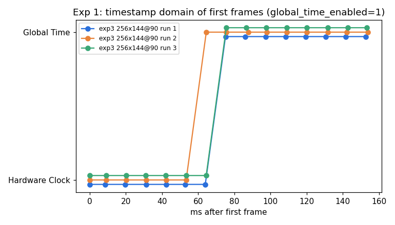
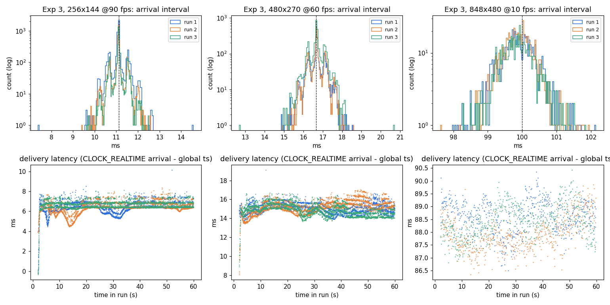
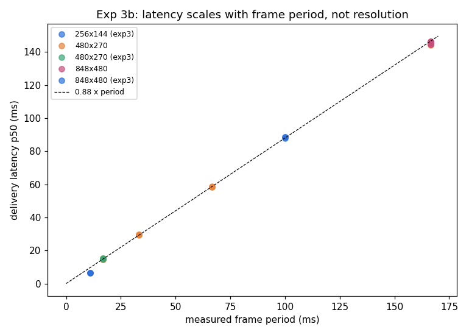
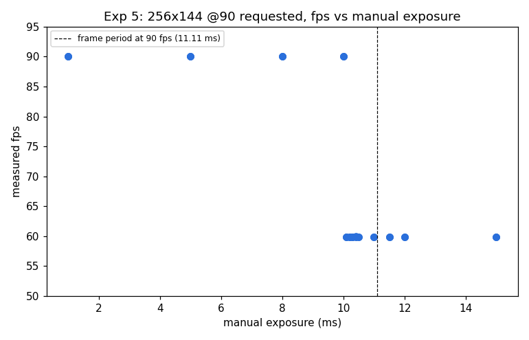
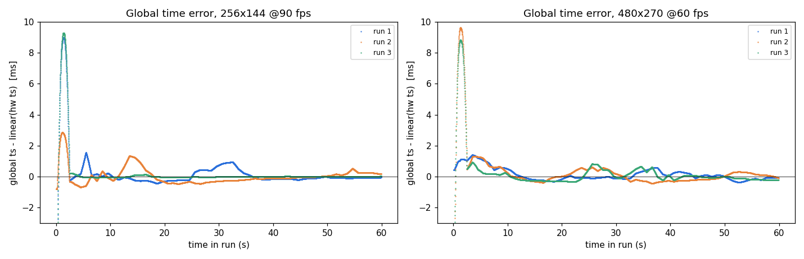

# Dual D435i capture on Jetson Orin Nano: measured unknowns

Status: **single camera, USB 2.0 only.** Camera B could not enumerate (cable fault) and was unplugged. No USB 3.0 cable is
available, so camera A runs at 480 Mbit/s and the target mode 848x480 Z16 @90 fps cannot be selected.
Everything below is measured on camera A only. All paths are relative to `~/rs_investigation/` on the Jetson.

## Summary

| # | Unknown | Status | Measured value | Recommended design decision |
|---|---|---|---|---|
| 0 | System and cameras | Answered (A), blocked (B) | L4T R36.4.3 (JetPack 6.2), kernel 5.15.148-tegra PREEMPT, 25W, schedutil. librealsense 2.59.1 RSUSB (home build). A = 234322070408, FW 5.17.3.10, **USB 2.1 / 480M**. B: no enumeration (`error -71`, "Maybe the USB cable is bad?") | Use USB 3 cables and verify `usb_type_descriptor` starts with "3." at startup; refuse to run otherwise |
| 1 | Hardware timestamps available? | Answered | gt=0: 100% Hardware Clock. gt=1: Global Time, **but the first 48-76 ms (3-7 frames) of every stream are Hardware Clock**. Never System Time. All 5 requested metadata fields present (Actual Fps missing on the first frame and on the domain-switch frame) | The matcher must check `get_frame_timestamp_domain()` on every frame and drop or hold frames until the domain is Global Time |
| 2 | Modes and options | Partly answered | On USB2: no 848x480@90 or 640x480@90. Highest depth fps: 256x144@90. 848x480 max 10 fps, 640x480 max 30 fps. `inter_cam_sync_mode` 0-4 (def 0), `frames_queue_size` 0-32 (def 16), exposure 1-165000 us (def 8500), AE 0/1 (def 1), `global_time_enabled` def 1. **Stored AE limit = 165000 us** (default 8500) | Repeat on USB 3. Set every option explicitly at startup; do not rely on the camera's stored state |
| 3 | One camera at 90 fps | Partly answered (256x144 only) | 256x144@90, 3x60 s: 90.02 fps, **0 dropped**, hw interval 11.110 ms (flat), arrival interval p50 11.107 / p99 12.06 / max 14.57 ms, latency p50 6.4 / p99 7.5 ms, CPU 2%. **Pass** | Baseline transport behaves. Re-run at 848x480@90 on USB 3 before relying on it |
| 3b | Delivery latency | Answered (USB2) | Latency = **0.87-0.89 x frame period**, independent of resolution. At 90 fps that predicts ~9.8 ms | Budget about one frame period of latency from end of exposure to callback |
| 4 | Two cameras at 90 fps | **Blocked** | - | Needs camera B on a working USB 3 cable |
| 5 | Exposure vs frame rate | Answered (256x144@90) | 90 fps holds to **10000 us**; **>= 10100 us gives a step to 60 fps** (not a gradual drop). AE picks **2240 us** in the current light. With the stored 165 ms AE limit, AE can go above 10 ms in dim light and drop to 60 fps | Set `auto_exposure_limit` <= 10000 us (or use manual exposure <= 10000 us). Monitor Actual Fps metadata at runtime |
| 5b | AE at 848x480 | Answered (USB2) | **AE does not run at 848x480** (metadata AE=0, exposure frozen at the previous value) although the option reads 1. AE works at every other mode tested | Re-check on USB 3. Until then, use manual exposure at 848x480 |
| 5c | Requested fps not applied | Answered (USB2) | After 848x480@6, re-opening 848x480@8 or @10 still streams at **6 fps** (3/3 sequences). A stream at another resolution in between clears it | Verify the actual rate from metadata after every start; restart the sensor if it does not match |
| 5d | Start-up stall | Answered (frequency estimate) | **1 of 160 starts** delivered 0 frames for 20 s with no SDK or kernel error | Watchdog: if no frame within ~3 frame periods after start, stop/close/reopen |
| 6 | Offset and drift between cameras | **Blocked** (partial data) | Camera A hw clock vs host CLOCK_MONOTONIC: **-98 to -104 ppm** (9 runs). Global time error vs ideal linear map: up to **9.6 ms in the first 3 s**, settles <1 ms in 2.4-6 s (worst 28.7 s), afterwards wander p99 0.13-1.30 ms, max 1.34 ms | Discard the first ~5 s after start. Do not rely on a 1 ms match tolerance with global time; prefer own hw-timestamp regression or frame-counter pairing (to be confirmed with 2 cameras) |
| 7 | Sync modes without cable | **Blocked** | - | Needs camera B |
| 8 | Callback cost | Partly answered (1 camera, 848x480 frames at 10 fps) | Log only p99 89 us; **memcpy of 814 KB p50 213 / p99 290 / max 742 us**; keep+queue p99 119 us. 0 drops in all | memcpy into the preallocated ring buffer is affordable (< 7% of a 90 fps period, worst case). Re-measure with 2 cameras at 90 fps |
| - | System health | Answered | 0 USB errors or resets for camera A in 160 starts; tj max 42.6 C; no throttling | - |

## Before reading the results

- **Clocks.** The Jetson wall clock is wrong (2023-11-21, not NTP synced, no network). All timing uses `CLOCK_MONOTONIC`. Global
  timestamps from the SDK are in the `CLOCK_REALTIME` time base, so latency is `arrival CLOCK_REALTIME - global ts`. The realtime
  clock did not step during the runs, because it is not synchronised.
- **Kernel lines.** RSUSB detaches `uvcvideo` when the SDK opens the camera and reattaches it on close. Each run therefore logs
  24-51 kernel lines (`Found UVC`, `Unknown video format`, `input:`). These are normal. The analysis counts only error, reset and
  throttle lines; there were none for camera A.
- **Callback.** The test callback writes one fixed-size record into a preallocated array (no I/O, no allocation). The CSV is
  written after streaming stops.
- **Pass/fail windows.** "After the first 2 s" is used for exp 3 as specified. Section 6 shows that the global time estimator
  is not settled at 2 s.

---

## Experiment 0. Inventory

**Question.** What hardware and software is this, and how are the cameras connected?
**Method.** System files, `nvpmodel`, sysfs, `lsusb -t`, kernel log; after the SDK install, `rs_probe inventory` (5 repeats).
**Logs.** `logs/exp0_inventory_raw.txt`, `logs/exp0_usb_detail.txt`, `logs/exp0_topology_change_*.txt`,
`logs/exp0_exp2_sdk_inventory.txt`, `logs/exp0_inventory_repeatability.txt`, `report/exp0_inventory.md`.

| Item | Value |
|---|---|
| Board | Jetson Orin Nano Engineering Reference Developer Kit Super |
| L4T / JetPack | R36.4.3 / 6.2 (inferred, `nvidia-jetpack` meta package not installed) |
| Kernel | 5.15.148-tegra, SMP PREEMPT (not RT) |
| Power mode | 25W (mode 1) |
| CPU governor | schedutil, 6 cores, max 1.344 GHz |
| librealsense | 2.59.1, **RSUSB backend**, built in `~/.local` |
| Camera A | serial 234322070408, ASIC 229123060143, FW 5.17.3.10, `usb_type_descriptor` 2.1, kernel 480M, port 1-2.4 |
| Camera B | Not identified. Port 1-2.3, then 1-2.1: repeated `error -71`, "Cannot enable. Maybe the USB cable is bad?", continuous re-enumeration. Unplugged at about 16:59 |
| Topology | Both cameras were on the same Realtek USB 2.0 hub (Bus 01). Nothing was on the USB 3.0 side of the hub (Bus 02, 10 Gbps) |

**Result.** Camera A is usable on USB 2. Camera B is not usable with its cable.
The first SDK enumeration (16:55) saw 2 devices and failed with "cannot access depth sensor". This was B, briefly enumerated:
the reconnect loop restarted when `udevadm trigger` ran. The 5 later inventories were identical (md5 6dd1b964).
**Confidence.** High.
**Effect on the design.** The program must check `usb_type_descriptor` at startup and refuse a USB 2 link. It should
identify cameras by serial, not by port or enumeration order, and survive a device that appears and disappears.

## Experiment 1. Timestamp domain and metadata

**Question.** Does the SDK get hardware timestamps on this system?
**Hypothesis.** With the RSUSB backend, metadata is read from the UVC payload header, so it is available without kernel
patches. The domain is Hardware Clock with gt=0 and Global Time with gt=1.
**Method.** `src/exp1.sh`: 10 s at 256x144@90 and 848x480@10 with `global_time_enabled` 0 and 1. Domain and metadata
recorded for every frame. The domain switch was then checked in all 9 runs of exp 3.
**Metrics.** Domain per frame; fraction of frames with each metadata field.
**Pass criterion.** gt=0: Hardware Clock. gt=1: Global Time. Never System Time.
**Result.**

| Field | Available |
|---|---|
| Frame Counter, Frame Timestamp, Sensor Timestamp, Actual Exposure, Auto Exposure, Gain Level, Time Of Arrival | 100% |
| Actual Fps | 99.8-99.9% (missing on frame 0 and on the domain-switch frame) |
| Backend Timestamp | Present but always 0 with RSUSB |

- gt=0: 100% Hardware Clock (894/894 and 98/98 frames). **Pass.**
- gt=1: Global Time, except **the first 3-7 frames (first Global frame 48-76 ms after the first frame)**, which are Hardware
  Clock. Seen in 7 of 7 runs at 60-90 fps (`logs/exp1b_domain_transition.txt`, plot `exp1_domain_switch.png`). At 10 fps
  the first frame arrives after ~100 ms and is already Global. The timestamp value jumps from ~2e5 ms to ~1.7e12 ms at the switch.
  **Partial pass:** never System Time, but not Global Time from the first frame.
- `Frame Timestamp - Sensor Timestamp` equals half the exposure (848x480@10: 673 us at 1346 us exposure). The frame
  timestamp therefore marks the end of exposure, and the sensor timestamp marks mid-exposure.
- Actual Fps is reported x1000 (90009 = 90.009 fps).

**Confidence.** High.
**Effect on the design.** The matcher must read the domain on every frame and not pair frames until both cameras report
Global Time. For pairing by exposure time, use Sensor Timestamp (mid-exposure).



## Experiment 2. Available modes and options

**Question.** Are 848x480 Z16 @90 and 640x480 Z16 @90 available, and what are the option ranges?
**Method.** `rs_probe inventory`. **Log.** `logs/exp0_exp2_sdk_inventory.txt`.
**Pass criterion.** Both 90 fps modes listed.
**Result. Fail on USB 2.** Depth Z16 profiles on this link: 1280x720@6; 848x480@6/8/10; 640x480@6/15(default)/30; 640x360@30;
480x270@6/15/30/60; 256x144@90. The SDK restricts profiles by link speed, and 848x480@90 needs ~586 Mbit/s of payload.

| Option (Stereo Module) | Min | Max | Step | Default | Current |
|---|---|---|---|---|---|
| inter_cam_sync_mode | 0 | 4 | 1 | 0 | 0 |
| frames_queue_size | 0 | 32 | 1 | 16 | 16 |
| exposure (us) | 1 | 165000 | 1 | 8500 | 8500 |
| enable_auto_exposure | 0 | 1 | 1 | 1 | 1 |
| global_time_enabled | 0 | 1 | 1 | 1 | 1 |
| auto_exposure_limit (us) | 1 | 165000 | 1 | 8500 | **165000** |
| auto_exposure_limit_toggle | 0 | 1 | 1 | 0 | 0 |

**Confidence.** High for USB 2. The USB 3 profile list is unknown.
**Effect on the design.** The 90 fps target needs USB 3. The camera has non-default stored state (AE limit 165000), so the
program must set every option it depends on explicitly.

## Experiment 3. One camera at 90 fps (baseline)

**Question.** Does one camera deliver a steady 90 fps to a callback?
**Hypothesis.** Yes, at the only 90 fps mode available on USB 2 (256x144).
**Method.** `src/exp3.sh`: 3 x 60 s each at 256x144@90, 480x270@60, 848x480@10. gt=1, AE on (default). Per-frame CSV,
tegrastats at 200 ms, kernel log. Metrics computed after the first 2 s.
**Metrics.** Mean fps, dropped frames (gaps in the frame counter), interval p50/p99/max (hardware and arrival), delivery
latency, callback time, CPU load.
**Pass criterion.** No drops after 2 s; p99 interval < 13 ms (at 90 fps).
**Result (median / worst of 3 runs).** `logs/exp3_summary.txt`, `logs/exp3_agg.txt`

| Mode | fps | Drops | HW interval p99 | Arrival p50 / p99 / max | Latency p50 / p99 / max | Callback p50 / p99 / max (log only) | CPU mean |
|---|---|---|---|---|---|---|---|
| 256x144@90 | 90.021 / 90.020 | 0 / 0 | 11.110 ms | 11.107 / 12.04 (worst 12.06) / 12.58 (worst 14.57) ms | 6.44 / 7.48 / 8.36 (worst 10.15) ms | 4.0 / 71 / 101 (worst 105) us | 1.9% |
| 480x270@60 | 59.908 | 0 | 16.694 ms | 16.689 / 17.72 / 18.61 (worst 20.71) ms | 15.0 / 16.2 / 17.0 (worst 19.1) ms | 5.0 / 81 / 117 (worst 152) us | 2.1% |
| 848x480@10 | 10.011 | 0 | 99.898 ms | 99.87 / 101.4 / 101.96 ms | 88.4 / 89.8 / 90.3 ms | 44 / 91 / 137 (worst 174) us | 1.8% |

- 256x144@90: **Pass** (0 drops, arrival p99 12.06 ms < 13 ms in the worst run).
- Hardware interval is constant to the microsecond: the camera does not jitter. All arrival jitter (±1 ms, rare 3.5 ms) comes
  from the USB and host side.
- No kernel errors; tj max 41.1 C.

**Unusual result → follow-up 3b (latency).** The latency grew with the frame period. `src/exp3b_latency.sh`: same resolution
at different fps, manual exposure 1 ms, 3 x 15 s each (`logs/exp3b_latency_table.txt`).

| Mode | Period | Latency p50 | Latency / period |
|---|---|---|---|
| 480x270@60 | 16.69 ms | 14.75 ms | 0.884 |
| 480x270@30 | 33.30 ms | 29.72 ms | 0.892 |
| 480x270@15 | 66.60 ms | 58.51 ms | 0.879 |
| 480x270@6 | 166.5 ms | 144.4 ms | 0.867 |
| 848x480@6 | 166.5 ms | 145.9 ms | 0.876 |

Latency is 0.87-0.89 of the frame period and does not depend on resolution (480x270 and 848x480 at the same period: 144.4 vs
145.9 ms). At 256x144@90 it was 0.58 of the period. This is consistent with the camera spreading each frame's transfer over
the frame interval, but the mechanism is not proven.

**Unusual result → follow-up 3c (wrong fps).** In 3b, 848x480@8 and @10 streamed at 6 fps. See experiment 5c.

**Confidence.** High for the 256x144@90 transport result. **Not measured: 848x480@90**, which needs USB 3 and has 11x the
payload.
**Effect on the design.** With the frame timestamp at end of exposure, expect roughly one frame period (~10 ms at 90 fps)
between exposure and callback. The camera clock itself is clean, so jitter handling belongs in the host path, not the
timestamps.




## Experiment 4. Two cameras at 90 fps

**Status: blocked.** Needs camera B on a working USB 3 cable. On the current hardware, the two cameras shared one USB 2.0 hub,
and 848x480@90 is not offered at all on USB 2. This alone shows that the USB 2 path cannot carry the target.
The fps and resolution matrix was not run, because it is meaningless with one camera on USB 2.

## Experiment 5. Exposure and frame rate

**Question.** Does exposure reduce the frame rate, and from which value? What does AE choose here?
**Hypothesis.** The frame rate drops when exposure plus readout exceeds the frame period (11.11 ms).
**Method.** `src/exp5.sh` and follow-up F3 in `src/exp_followups.sh`: 256x144@90 requested (the frame period is the same at
848x480@90). AE, and manual 1, 5, 8, 10, 10.1, 10.2, 10.3, 10.4, 10.5, 11, 11.5, 12, 15 ms. 3 runs each (20 s, or 10 s for F3).
**Metrics.** Measured fps, hardware interval, Actual Exposure metadata.
**Pass criterion.** Find the threshold and the AE value.
**Result.** `logs/exp5_table.txt`, `logs/followups_table.txt`.

| Exposure | Measured fps (all runs) |
|---|---|
| AE (chooses 2240 us) | 90.02 |
| 1000-10000 us | 90.02 |
| **10100-15000 us** | **59.91** (period 16.694 ms) |

- The drop is a **step from 90 to 60 fps**, between 10000 and 10100 us (about 1.1 ms below the frame period).
- AE converges within a few frames from a starting value of 9947 us to **2212-2268 us** in the current light.
- At lower frame rates, AE starts at the maximum the frame period allows (164822 us at 6 fps, 64921 at 15, 32783 at 30) and
  converges down within about 1 s.
- **Risk:** the stored AE limit is 165000 us. In darker light, AE may choose more than 10000 us, which drops the camera to
  60 fps without any error.

**Unusual result → 5b (AE inactive at 848x480).** At 848x480 (6, 8 and 10 fps), the option reads `enable_auto_exposure=1`,
but the metadata AE flag is 0 on every frame, and the exposure stays at the value left by the previous run (1346, 2296,
1930, 1000 us). Follow-up F1 (`logs/followups_table.txt`, 3 runs per mode): AE works at 256x144@90, 480x270@6/15/30,
640x360@30 and 640x480@15/30, and **never at 848x480@10**. The cause is the resolution, not the frame rate.
This consequently means exp 1 and exp 3 ran 848x480 with a frozen exposure, which does not affect their timing conclusions.

**Unusual result → 5c (wrong frame rate).** After a stream at 848x480@6, re-opening 848x480 at 8 or 10 fps streams at 6 fps
(Actual Fps metadata 6.007; 3 of 3 sequences in F2). In exp 3c, 18 runs of 848x480@10 that were not preceded by 848x480@6
all ran at 10 fps. A stream at a different resolution in between clears the state.

**Unusual result → 5d (start-up stall).** One run (`logs/exp5_A_exp10500_r1`) received **0 frames** in 20 s. The SDK
reported no error and the kernel logged nothing. Follow-up F4: 30 further start/stop cycles at 10500 us and auto exposure
had no stall. Total: 1 stall in 160 starts.

**Confidence.** High for the threshold and the AE value; medium for the 848x480 AE and fps findings (USB 2 only, cause not
known); low for the stall rate (1 event).
**Effect on the design.**
- Set `auto_exposure_limit` to 10000 us or less (or use manual exposure up to 10000 us) at 90 fps.
- After every start, check Actual Fps and the hardware interval against the requested rate; restart on mismatch.
- Add a no-frame watchdog (for example, 3 frame periods) that stops, closes and reopens the sensor.
- Re-check AE at 848x480 on USB 3.



## Experiment 6. Clock offset and drift between free-running cameras

**Status: blocked** (needs two cameras). Not measured: the A-B difference, the relative rate in ppm, and the pair rate at
5.56, 2 and 1 ms.

**What one camera can show** (`src/clock_drift.py`, `src/globaltime_error.py` on the 9 exp 3 runs):

- **Camera clock vs host.** Camera A's hardware clock runs **98-104 ppm fast** relative to `CLOCK_MONOTONIC`
  (`logs/exp6pre_camera_vs_host_drift.txt`). This means about 0.37 ms per minute. Two free-running cameras of the same model
  can be expected to differ by tens of ppm, so a fixed offset is not enough.
- **Global time stability** (global ts minus the best linear map of hw ts, `logs/exp6pre_globaltime_error.txt`):

| | Value |
|---|---|
| Error in the first 3 s | up to 9.6 ms (5 of 9 runs > 2.8 ms) |
| Settled to < 1 ms after | 2.4-6 s typically; worst 28.7 s |
| After 10 s: p50 / p99 / max | 0.01-0.29 / 0.13-1.30 / 1.34 ms |
| Shape | Slow excursions of 0.5-1.5 ms that last 5-15 s |

**Confidence.** High for one camera.
**Effect on the design (prediction, to be confirmed with 2 cameras).**
- Discard frames from the first ~5 s, or until the global-time error is small.
- Each camera's global time can wander by up to ~1.3 ms on its own. The A-B difference could therefore reach ~2.6 ms, which
  would break a 1 ms tolerance and could break a 2 ms one.
- Half a frame period (5.56 ms) should be safe after settling.
- An alternative is to do our own linear regression of hw timestamps against arrival time per camera, which avoids the SDK
  estimator's excursions.



## Experiment 7. Sync modes with no cable

**Status: blocked** (needs camera B). This test would not prove that hardware sync works at 90 fps in any case.
`inter_cam_sync_mode` is accepted in the range 0-4 on camera A; it was never changed during this work and is 0.

## Experiment 8. Callback cost

**Status: partly answered**: one camera, 848x480 Z16 frames (the target frame size), 10 fps because of USB 2.
`src/exp8_single.sh`, 3 x 60 s per callback type. `logs/exp8_single_agg.txt`.

**Question.** Can the callback copy the frame, or must it pass a frame handle?
**Hypothesis.** A copy of 814 KB costs a few hundred microseconds, which is small compared with an 11.1 ms frame period.
**Method.** Three callbacks: (a) log only, (b) `memcpy` of the full frame into a preallocated buffer, (c) `frame.keep()` and a
push of the handle into a 16-slot lock-free SPSC queue that a second thread empties. Callback time is measured from entry
to exit with `CLOCK_MONOTONIC`.
**Metrics.** Callback time p50/p99/max, drops, CPU.
**Pass criterion.** Callback p99 much less than the 11.1 ms frame period at 90 fps, and no drops.
**Result (median / worst of 3 runs).**

| Callback | p50 | p99 | max | Drops | Queue full | CPU mean |
|---|---|---|---|---|---|---|
| (a) log only | 33 / 62 us | 89 / 90 us | 137 / 184 us | 0 | - | 1.7% |
| (b) memcpy 814 KB | **213 / 215 us** | **290 / 302 us** | 367 / **742 us** | 0 | - | 1.7% |
| (c) keep + SPSC push | 53 / 75 us | 119 / 122 us | 132 / 135 us | 0 | 0 | 2.1% |

- The memcpy costs about 180 us more than log-only, which is about 4.5 GB/s. The worst callback (742 us) is 6.7% of the 11.1 ms
  frame period.
- Two cameras at 90 fps with memcpy would spend about 180 x 0.21 ms = 38 ms per second in the callbacks. That is about 4% of
  one core.

**Confidence.** Medium. The cost per frame at the target frame size is measured. The effect of two cameras at 90 fps (18x
the frame rate, memory-bandwidth contention, two SDK threads) is not measured.
**Effect on the design.** Copying into the preallocated ring buffer in the callback is affordable and keeps the SDK frame
pool free. Passing handles is cheaper (p99 0.12 ms) but holds SDK buffers until the matcher releases them, so a slow
matcher would starve the SDK queue (`frames_queue_size` 16). Recommendation: memcpy into the ring buffer, and re-measure
with two cameras on USB 3.

**Confidence.** Medium. The cost per frame at the target frame size is measured. The effect of two cameras at 90 fps (18x
the frame rate, contention between the two SDK threads) is not measured.

---

## Open items

| Item | What it needs |
|---|---|
| Exp 0: identify camera B (serial, FW) | A working cable for B |
| Exp 2/3: 848x480@90 and 640x480@90 profiles and baseline | **USB 3 cable** for camera A (verify `lsusb -t` shows 5000M) |
| Exp 4: two cameras at 90 fps, fps/resolution matrix, shared hub/controller, bandwidth limit | Two USB 3 cables. Also decide which ports: the dev kit's USB-A ports go through one onboard hub |
| Exp 5b/5c: AE at 848x480, fps carry-over | USB 3 link (to see if these are USB 2 or firmware behaviour) |
| Exp 5d: stall rate | Several hundred start/stop cycles, preferably on USB 3 |
| Exp 6: A-B offset, relative ppm, pair rates at 5.56/2/1 ms, 15 min with gt 0 and 1 | Two cameras on USB 3 |
| Exp 7: sync modes without cable (limited test) | Camera B |
| Exp 8: callback cost with 2 cameras at 90 fps | Two cameras on USB 3 |
| **Hardware sync accuracy** (sync cable tests) | Sync cable between the cameras (pins 5 (SYNC) and 9 (GND) on the 9-pin connector), then: master/slave at 90 fps, sensor-timestamp difference distribution, behaviour on cable removal |
| Camera clock vs real time | Network/NTP on the Jetson (wall clock is in 2023) if absolute time matters downstream |

## Changes made on the Jetson

| Change | Location | Undo |
|---|---|---|
| Source tarballs: librealsense v2.59.1, libusb 1.0.30, nlohmann/json 3.12.0 (downloaded on the Mac, sha256 in this session's log: 8de92d31..., fea36f34..., 4b92eb0c...) | `~/rs_investigation/deps/` | `rm -rf ~/rs_investigation/deps` |
| libusb 1.0.30 (headers and .so) | `~/.local/include/libusb-1.0`, `~/.local/lib/libusb-1.0*` | remove these |
| nlohmann/json 3.12.0 headers and CMake config | `~/.local/include/nlohmann`, `~/.local/share/cmake/nlohmann_json` | remove these |
| librealsense 2.59.1: RSUSB, `ENABLE_STATS=OFF` (no telemetry), `CHECK_FOR_UPDATES=OFF`, `BUILD_ROSBAG2=OFF`, no examples, viewer, Python or CUDA | `~/.local/lib/librealsense2*`, `~/.local/include/librealsense2`, `~/.local/bin/rs-*`, `~/.local/lib/cmake/realsense2` | remove these |
| udev rule (installed by the user with sudo) | `/etc/udev/rules.d/99-realsense-libusb.rules` | `sudo rm /etc/udev/rules.d/99-realsense-libusb.rules && sudo udevadm control --reload-rules` |
| Camera A options during tests (not persistent between power cycles, restored to auto exposure at the end) | camera | - |

Not changed: system clock, kernel, firmware, nvpmodel, CPU governor, apt packages, `inter_cam_sync_mode`, `auto_exposure_limit`.

## Reproduce

```
# once: offline dependency build (~10 min) and udev rule (sudo, see above)
~/rs_investigation/deps/build_deps.sh
# all single-camera experiments, analysis and plots (~65 min)
~/rs_investigation/src/run_all.sh
```

| File | Purpose |
|---|---|
| `src/rs_probe.cpp`, `src/build.sh` | Test tool (`inventory`, `capture`) |
| `src/run_capture.sh` | One run with tegrastats and kernel log → `logs/RUN/` |
| `src/exp0.sh`, `exp1.sh`, `exp3.sh`, `exp3b_latency.sh`, `exp3c_fps_anomaly.sh`, `exp5.sh`, `exp_followups.sh`, `exp8_single.sh` | One script per experiment |
| `src/analyze.py`, `clock_drift.py`, `globaltime_error.py`, `plots.py` | Analysis |

Each `logs/RUN/` directory has `frames.csv` (one row per frame), `stdout.txt`, `tegrastats.txt`, `kernel_new.txt`,
`meta.txt` and `summary.json`.
